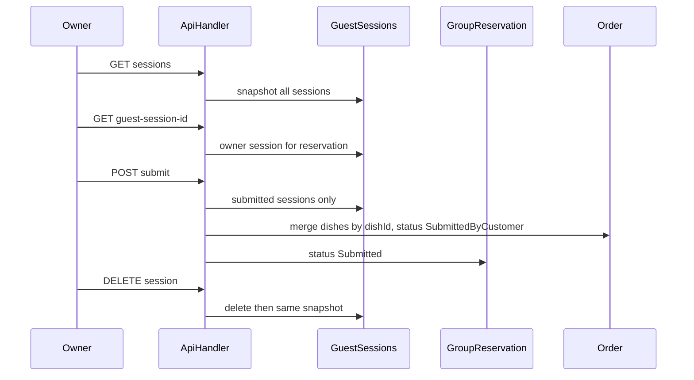

# Owner group pre-order APIs

Homework source: [homework-backend.md](homework-backend.md). All work is in [backend/restaurant-backend-app](backend/restaurant-backend-app). Frontend is out of scope.

Use **homework paths**, not the older swagger/docs variants:

- `GET /guest/groups/{groupReservationId}/sessions`
- `GET /reservations/{reservationId}/guest-session-id`
- `POST /group-reservations/{groupReservationId}/submit`
- `DELETE /guest/groups/{groupReservationId}/sessions/{guestSessionId}` (already routed)

Swagger currently documents submit as `/guest/groups/.../submit`; follow the homework path instead.

## What already exists

- Guest session entity already has `IsSubmitted`, `IsOwnerSession`, `OwnerUserId`, `Dishes` ([GuestSession.cs](backend/restaurant-backend-app/dnapp/lambdas/api-handler/Entities/GuestSession.cs)).
- Snapshot DTO already matches homework: [GetAllResponse.cs](backend/restaurant-backend-app/dnapp/lambdas/api-handler/Models/GuestSessions/GetAllResponse.cs) + nested `dish` in [OrderItemResponse.cs](backend/restaurant-backend-app/dnapp/lambdas/api-handler/Models/Orders/OrderItemResponse.cs).
- Level 3 delete is implemented in [DeleteGuestSessionHandler.cs](backend/restaurant-backend-app/dnapp/lambdas/api-handler/Handlers/GuestSessions/DeleteGuestSessionHandler.cs) and [GuestSessionService.DeleteGuestSessionAsync](backend/restaurant-backend-app/dnapp/lambdas/api-handler/Services/GuestSessions/GuestSessionService.cs): owner check, 404/400, then rebuild snapshot.
- `CreateGroupOwnerSessionAsync` exists on the concrete service but is **not** on [IGuestSessionService](backend/restaurant-backend-app/dnapp/lambdas/api-handler/Services/GuestSessions/IGuestSessionService.cs) and is **never called**. [CreateGroupReservationIfDoesNotExistAsync](backend/restaurant-backend-app/dnapp/lambdas/api-handler/Services/GroupReservations/GroupReservationService.cs) creates the group only.

## Gaps to close

1. **Owner session lifecycle.** Create an owner `GuestSession` when the group is created. Add `CreateGroupOwnerSessionAsync` to the interface and call it from `CreateGroupReservationIfDoesNotExistAsync` after `CreateGroupReservationAsync`. For older groups, lazily create the owner session in `GET .../guest-session-id`.
2. **Guest counting.** Today `CountByGroupReservationId` + `+ 1` assumes the owner is not stored. After persisting an owner session, exclude `IsOwnerSession` from guest-limit counts in `CreateGuestSessionAsync`, `GetGroupReservationByTokenAsync`, and `GetCurrentParticipantCountAsync`, or the table will fill one seat too early.
3. **Snapshot reuse.** Extract the mapping in `DeleteGuestSessionAsync` (load sessions, hydrate dishes, compute totals) into something like `GetAllSessionsAsync`. Use `ParticipantType.Owner` when `IsOwnerSession` and resolve the owner display name the same way `GetGuestSessionInfoAsync` already does (`given_name`).
4. **JSON casing.** Delete currently uses `ResponseBuilder.CreateSuccessResponse(object)`, which serializes PascalCase. Return snapshots with `CreateJsonResponse` (camelCase) for GET and DELETE.

## Level 1 — list sessions

New handler (mirror [DeleteGuestSessionHandler](backend/restaurant-backend-app/dnapp/lambdas/api-handler/Handlers/GuestSessions/DeleteGuestSessionHandler.cs)): Cognito `sub`, path `groupReservationId`, owner-only via existing `ValidateReservationOwnerAsync`.

- 401 if no user
- 403 if not reservation owner
- 404 if group/reservation missing
- 200 `{ participants, total }`

Register in [RouteRegistry.cs](backend/restaurant-backend-app/dnapp/lambdas/api-handler/Routing/RouteRegistry.cs) `GetGuestAndGroupRoutes`.

Fix API Gateway in [deployment_resources.json](backend/restaurant-backend-app/deployment_resources.json): the existing path is mistyped as `/guest/group/{groupReservationId}/sessions`. Change to `/guest/groups/{groupReservationId}/sessions` with `GET` + `cognito_authorizer`. Keep DELETE on `/guest/groups/{groupReservationId}/sessions/{guestSessionId}`.

## Level 2 — owner session id + submit

**GET `/reservations/{reservationId}/guest-session-id`**

- Load reservation (404), require `CustomerId == sub` (403).
- Load group by reservation id (404).
- Find session with `IsOwnerSession`; create if missing.
- Return `{ "guestSessionId": "..." }`.
- Add API GW resource next to `/reservations/{reservationId}/invite-token` (Cognito).

**POST `/group-reservations/{groupReservationId}/submit`**

Body: `{ "reservationId": "..." }` via `RequestBodyHelper`.

Logic (Owner only):

- 404 if group or reservation missing
- 400 if body `reservationId` does not match the group’s reservation
- 403 if caller is not owner
- Load all sessions; keep only `IsSubmitted`
- 400 if none submitted, or submitted sessions have no dishes
- Load order by reservation id; 400 if missing (`ValidationException`, same as existing order flow)
- Merge items by `dishId` (sum quantities); write that list onto the order (`OrderItemState.Pending` for new lines)
- Set order status `SubmittedByCustomer`, group status `Submitted`
- Return `[{ dishId, quantity }, ...]`

Put this on [IGroupReservationService](backend/restaurant-backend-app/dnapp/lambdas/api-handler/Services/GroupReservations/IGroupReservationService.cs) (inject `IOrderRepository`). Optional: 400 if group is already `Submitted` using `GroupReservationSubmittedException`.

Add API GW `POST /group-reservations/{groupReservationId}/submit` with Cognito.

## Level 3 — delete (finish, don’t rebuild)

Keep the existing delete route. After extracting snapshot:

- Return the same GET payload
- Keep 400 when session belongs to another group, 404 when missing
- Do not allow deleting the owner session (400) so submit/session-id keep working
- Add unit tests (none exist today)

## Tests

Extend [GuestSessionServiceTests.cs](backend/restaurant-backend-app/Tests/Services/GuestSessionServiceTests.cs) and [GroupReservationServiceTests.cs](backend/restaurant-backend-app/Tests/Services/GroupReservationServiceTests.cs):

- Snapshot includes owner + guests, totals, `isSubmitted`
- Owner-only rejection
- Delete rebuilds snapshot / wrong group / missing session / owner session
- Owner session id found or created
- Submit merges dishes, updates statuses, and each 400/404 case
- Guest limit still works when an owner session row exists

## Docs (light)

Update [ApiRoutes.md](backend/restaurant-backend-app/docs/ApiRoutes.md) GET sessions / DELETE / submit response shapes to match homework. Optionally align swagger submit path; not required for the assignment itself.